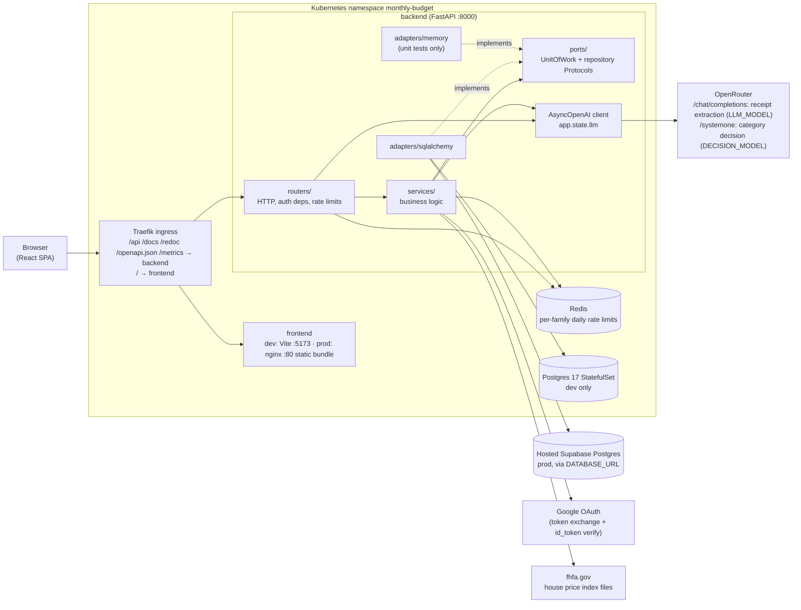

# Architecture

How the pieces fit at runtime, and the contracts that cross component boundaries. Scoped
detail lives in the `AGENTS.md` next to the code; the route-by-route API contract is generated
into [api-contract.md](api-contract.md).

## Runtime topology

- **Migrations:** dev runs them in the `backend-migrate` Job (Tilt); the production image's
  `entrypoint.sh` runs `alembic upgrade head` before gunicorn, which is why the homelab backend
  Deployment uses `strategy: Recreate` with one replica.
- **Production deploy** lives in a separate homelab repo (`manifests/apps/monthly-budget`):
  pinned `ghcr.io/jburns24/monthly-budget/{backend,frontend}:<version>` images, a hash-suffixed
  `monthly-budget-env` Secret and a `monthly-budget-config` ConfigMap (`LLM_MODEL`,
  `DECISION_MOCK=false`). This repo's `manifests/` is the dev stack only.
- **Dev-only routes** (`/api/auth/dev-login`, `/api/test/reset`, `/api/dev/*`) mount only when
  `ENVIRONMENT` is `development` or `test`.

## Cross-component contracts

| Contract | Producer → consumer | Source of truth | Notes |
|---|---|---|---|
| HTTP API (paths, JSON schemas) | `backend/app/routers` + `schemas` → `frontend/src/api/*.ts` + `src/types/*.ts` | FastAPI OpenAPI → [api-contract.md](api-contract.md), [openapi.json](openapi.json) | Frontend types are hand-written; regenerate the contract (`task be:api-contract`) and update `src/types` together. CI fails if the generated files are stale. |
| Auth session | `routers/auth.py`, `services/jwt_service.py` → `frontend/src/api/client.ts`, `hooks/useAuth.ts` | [backend/app/routers/AGENTS.md](../backend/app/routers/AGENTS.md) | HttpOnly `access_token` / `refresh_token` cookies; `apiClient` refreshes once on 401. |
| Same-origin routing | ingress → frontend/backend | `manifests/base/ingress`, homelab ingressroute | The SPA only calls relative `/api/...`; nginx does not proxy `/api`. |
| Env / config | `manifests/overlays/dev/config/*.env`, homelab Secret/ConfigMap → `backend/app/config.py` `Settings` | `Settings` field defaults + `backend/.env.example` | Unknown env vars are ignored; `ANTHROPIC_MOCK*` are legacy aliases of `LLM_MOCK*`. |
| LLM provider | `services/claude_client.py`, `services/category_classifier.py` → OpenRouter | `LLM_BASE_URL`, `LLM_MODEL`, `DECISION_*`, `OPENROUTER_API_KEY` | One shared `AsyncOpenAI` client. Receipts: chat completions with a forced tool call. Categories: `POST /systemone` choice question to `microsoft/microsoft-decision-1` ([ADR 0002](adr/0002-category-suggester-decision-model.md)). |
| DB schema | `backend/app/models` → Alembic `versions/` → Postgres | [backend/alembic/AGENTS.md](../backend/alembic/AGENTS.md) | Single linear history; `pg_trgm` extension required. |
| Images / releases | `semantic-release.yaml` tag → `build-push.yaml` → GHCR → homelab | tag `backend/vX.Y.Z` / `frontend/vX.Y.Z` | Image tags drop the component prefix (`0.11.0`), built for amd64 + arm64. The same `X.Y.Z` is baked in as `APP_VERSION` (backend, `GET /api/version`) / `VITE_APP_VERSION` (frontend); the authenticated layout's footer shows both. |
